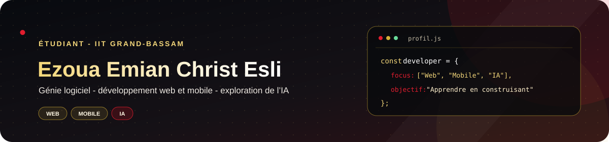

  

  Étudiant en génie logiciel à l’Institut Ivoirien de Technologie (IIT), Grand-Bassam, Côte d’Ivoire. 
  Je construis des projets web et mobiles et j’explore l’IA et l’analyse de données.

  
  
  

---

### À propos

- 🎓 Étudiant en Licence 2 de génie logiciel à l’IIT.
- 🔎 Intéressé par les applications utiles, le développement mobile et les données.
- 🤝 J’apprends en réalisant des projets, seul ou en équipe.
- 🎯 Je recherche un stage en développement logiciel.

### Technologies explorées

**Langages :** Python · JavaScript · Dart · C++ · HTML · CSS  
**Frameworks et outils :** Flutter · Django REST · PostgreSQL · Docker · Three.js · GSAP · Selenium · SQLite

### Projets en vedette

- **[YODO](https://github.com/Christ-Hub-pixel/YODO)** — boutique web multipage de démonstration, réalisée avec HTML, CSS, JavaScript, Three.js et GSAP. [Voir la démo](https://yodo-clothing-brand.vercel.app).
- **[Analyse Comparative de Marché](https://github.com/Christ-Hub-pixel/AnalyseComparativeMarche)** — outil Python en ligne de commande pour comparer des prix depuis des fichiers CSV, JSON et Excel, et simuler des paniers.
- **[CodeLingo](https://github.com/Christ-Hub-pixel/codelingo6)** — projet d’application Flutter en développement.
- **[Amazon Scraper](https://github.com/Christ-Hub-pixel/amazon_scraper)** — projet Python avec Selenium, export CSV et stockage SQLite pour une étude de marché.

[Parcourir tous mes dépôts →](https://github.com/Christ-Hub-pixel?tab=repositories)

### Distinctions

- 🥈 2ᵉ place — Hackathon IIT 2026
- 🥉 3ᵉ place — Vibeathon 2026

### Activité GitHub

  

  
  

### Contact

Pour parler d’un stage ou d’un projet, écris-moi via [mon portfolio](https://christ-hub-pixel.github.io/portfolio/) ou [LinkedIn](https://linkedin.com/in/emian-ezoua).